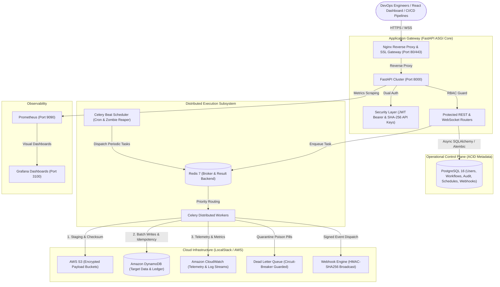
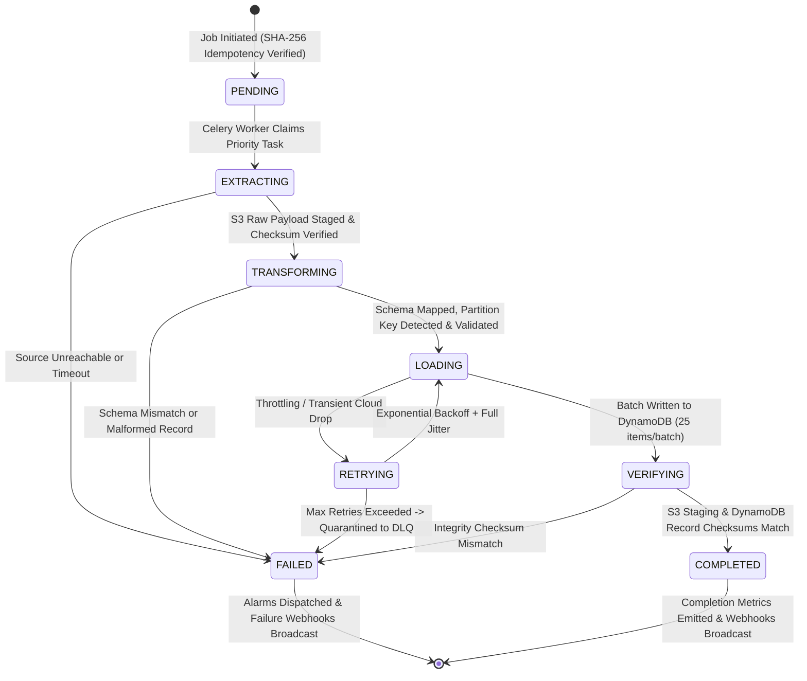

# AWS Cloud-Native Workflow Orchestrator & Migration Engine

[](https://www.python.org/)
[](https://fastapi.tiangolo.com/)
[](https://www.postgresql.org/)
[](https://redis.io/)
[](https://docs.celeryq.dev/)
[](https://react.dev/)
[](https://www.docker.com/)
[](https://pytest.org/)
[](https://pytest.org/)
[](https://bandit.readthedocs.io/)

An enterprise-grade, distributed cloud-native workflow orchestrator and automated database migration engine. Engineered to reliably migrate, transform, and replicate high-volume datasets from legacy relational systems into **Amazon DynamoDB** and **AWS S3** with zero data loss, strictly governed by a 6-phase **Finite State Machine (FSM)**, resilient circuit breakers, and a real-time **React 18** administration dashboard.

---

## Table of Contents

- [The Project in Simple Terms](#the-project-in-simple-terms)
- [System Architecture](#system-architecture)
- [6-Phase State Machine Lifecycle](#6-phase-state-machine-lifecycle)
- [Key Enterprise Features](#key-enterprise-features)
- [Pre-Configured Service Ports & Default Credentials](#pre-configured-service-ports--default-credentials)
- [Quickstart Guide (Local Development)](#quickstart-guide-local-development)
- [Production Deployment](#production-deployment)
- [Interactive API Walkthrough](#interactive-api-walkthrough)
- [React 18 Administration Dashboard](#react-18-administration-dashboard)
- [Resilience & Failure Recovery](#resilience--failure-recovery)
- [Pre-Configured Migration Templates](#pre-configured-migration-templates)
- [Quality Assurance & Security Benchmarks](#quality-assurance--security-benchmarks)
- [Repository Directory Structure](#repository-directory-structure)
- [Documentation Index](#documentation-index)
- [Author & Maintainer](#author--maintainer)

---

## The Project in Simple Terms

### What problem does this solve?
Migrating mission-critical data between databases is one of the riskiest operations in software engineering:
- **Network drops** midway through a transfer cause partial writes and split-brain states.
- **Poison-pill records** (malformed JSON, duplicate keys) crash entire worker fleets.
- **API throttling** from cloud providers (AWS DynamoDB `ProvisionedThroughputExceededException`) cascades into systemic failures.
- **Lack of visibility** leaves DevOps teams blind to which records succeeded, which failed, and why.

### How does this orchestrator solve it?
This platform provides an automated, self-healing pipeline that guarantees:
1. **Guaranteed Delivery (At-Least-Once & Idempotent)**: Every job is fingerprinted using SHA-256. Resending the same payload never results in duplicate writes.
2. **Zero-Data-Loss S3 Staging**: Raw payloads are safely encrypted and staged in AWS S3 before being touched by any worker.
3. **Adaptive Batch Writes**: High-throughput writes to Amazon DynamoDB (25 items/batch) with full-jitter exponential backoff and automated partition key schema detection.
4. **Dead Letter Queue (DLQ) Quarantine**: Poison pills are automatically isolated with full execution stack traces, without halting the rest of the batch. Quarantined records can be inspected and replayed via a single API call.
5. **Real-Time Visibility**: Live WebSocket progress streaming, Prometheus metrics, Grafana dashboards, and an interactive React 18 visual dashboard.

---

## System Architecture



---

## 6-Phase State Machine Lifecycle

Every migration strictly transitions through a governed, deterministic 6-phase state machine:



### Phase Details:
| Phase | Action | Failure Handling |
| :--- | :--- | :--- |
| **1. PENDING** | Request validated, idempotency key generated, enqueued into Redis priority queue | Rejects invalid payloads with RFC 7807 error |
| **2. EXTRACTING** | Worker claims task, uploads raw payload snapshot to encrypted S3 staging bucket | Circuit breaker prevents S3 overload |
| **3. TRANSFORMING** | Validates records, dynamically queries DynamoDB KeySchema, normalizes fields | Schema errors quarantine poisoned records |
| **4. LOADING** | High-speed batch writes (25 records/batch) to DynamoDB with auto-retry | Full-jitter backoff; exhausted retries move to DLQ |
| **5. VERIFYING** | Cross-validates record count and SHA-256 checksums between S3 and DynamoDB | Flags discrepancy; marks workflow failed for audit |
| **6. COMPLETED** | Emits Prometheus metrics, writes audit ledger, broadcasts HMAC-signed webhooks | Guaranteed execution via Celery task lifecycle |

---

## Key Enterprise Features

### 1. Dual-Storage Architecture
- **PostgreSQL 16 (Relational Control Plane)**: Handles ACID-compliant metadata—users, role-based access control (RBAC), API keys, workflow states, step transitions, schedules, webhooks, and immutable audit logs.
- **Amazon DynamoDB & S3 (Cloud Data Plane)**: Handles high-throughput target record storage and raw blob payload staging, emulated with zero cloud cost via LocalStack.

### 2. Dual Authentication & RBAC
- **Human Users (JWT Bearer Tokens)**: Short-lived access tokens (60 mins) and long-lived refresh tokens (7 days) with automated rotation.
- **Machine / CI/CD Clients (Hashed API Keys)**: Secure, high-entropy keys (`wfo_live_...`) hashed using SHA-256 before storage in PostgreSQL.
- **Three-Tier Role-Based Access Control**:
  - `admin`: Full system control (replay DLQ, create users, manage webhooks/schedules, revoke API keys).
  - `operator`: Initiate migrations, retry failed jobs, view health metrics, inspect workflows.
  - `viewer`: Read-only access to workflow statuses and public health probes.

### 3. Distributed Celery Execution & Queues
- Multi-queue task routing: `critical`, `high`, `default`, `low`, and `orchestrator_tasks`.
- Concurrency tuning per worker, preventing resource starvation under heavy burst traffic.
- Automated Celery Beat scheduler for recurring cron migrations and automated zombie task cleanup.

### 4. Circuit Breakers & Dead Letter Queue (DLQ)
- Per-service circuit breakers (`s3`, `dynamodb`, `cloudwatch`) fail fast during cloud degradation and automatically reset after a cooldown period.
- Poison pills are quarantined into the DLQ with full stack traces, request payloads, and failure counts, allowing safe one-click replay.

### 5. Webhook Engine with HMAC-SHA256 Signatures
- Subscribed HTTP endpoints receive cryptographically signed event notifications (`X-Orchestrator-Signature: sha256=...`).
- Automatic retries with exponential backoff on delivery failure.

### 6. Comprehensive Observability
- **Prometheus**: Custom middleware scraping request durations, active workflows, state transitions, and Celery queue depth (`/api/v1/metrics/prometheus`).
- **Grafana**: Pre-provisioned dashboards for workflow throughput, error rates, and resource utilization.
- **CloudWatch Telemetry**: Live log streams and custom metric filters.

---

## Pre-Configured Service Ports & Default Credentials

| Service | Host Port | Protocol | Description | Default Credentials |
| :--- | :--- | :--- | :--- | :--- |
| **React Dashboard** | `3000` | HTTP | Modern React 18 Admin Dashboard | `admin@company.com` / `DemoPassword123!` |
| **FastAPI Backend** | `8000` | HTTP | Core API & Swagger Docs (`/docs`) | JWT Bearer or `X-API-Key` |
| **Grafana** | `3100` | HTTP | Real-time Observability Dashboards | `admin` / `orchestrator_admin` |
| **Prometheus** | `9090` | HTTP | Metric Scraper & Time-Series DB | None (Internal) |
| **LocalStack AWS** | `4566` | HTTP | Local S3, DynamoDB, CloudWatch | `AWS_ACCESS_KEY_ID=test` |
| **PostgreSQL 16** | `5432` | TCP | Relational Control Plane DB | `postgres` / `postgres` |
| **Redis 7** | `6379` | TCP | Celery Broker & Result Cache | None |
| **Nginx (Prod)** | `80`, `443` | HTTP/S | Reverse Proxy & TLS Gateway | SSL / Production only |

---

## Quickstart Guide (Local Development)

### 1. Prerequisites
- **Python 3.12+**
- **Docker Engine 24.0+** & **Docker Compose v2.20+**
- **Node.js 18+** & **npm** (for local frontend dashboard)

### 2. Clone and Configure Environment
```bash
git clone https://github.com/anuragsinghmusics-wq/aws-cloud-workflow-orchestrator.git
cd aws-cloud-workflow-orchestrator
cp .env.example .env
```

### 3. Start Backend & Infrastructure Services
Launch PostgreSQL, Redis, LocalStack, Celery workers, and the FastAPI engine:
```bash
docker compose -f docker/docker-compose.yml up -d --build
```

Verify all containers are healthy:
```bash
docker compose -f docker/docker-compose.yml ps
```

### 4. Launch the React Dashboard
Open a new terminal to start the Vite development server:
```bash
cd dashboard
npm install
npm run dev
```

### 5. Open Your Browser
- **Dashboard**: [http://localhost:3000](http://localhost:3000)
  - Login with: **`admin@company.com`** / **`DemoPassword123!`**
- **Interactive Swagger Docs**: [http://localhost:8000/docs](http://localhost:8000/docs)
- **Grafana Monitoring**: [http://localhost:3100](http://localhost:3100) (Login: `admin` / `orchestrator_admin`)
- **System Health Endpoint**: [http://localhost:8000/api/v1/health/live](http://localhost:8000/api/v1/health/live)

---

## Production Deployment

The production deployment features Gunicorn multi-worker ASGI clustering, Nginx reverse proxy with TLS termination, OWASP security headers, and Prometheus/Grafana monitoring:

```bash
# 1. Build the production React dashboard bundle
cd dashboard
npm install
npm run build
cd ..

# 2. Launch the full 10-container production stack
docker compose -f docker/docker-compose.prod.yml up -d --build
```

---

## Interactive API Walkthrough

All API endpoints are prefixed with `/api/v1`.

### 1. Register an Account
```bash
curl -X POST http://localhost:8000/api/v1/auth/register \
  -H "Content-Type: application/json" \
  -d '{
    "email": "devops@company.com",
    "password": "SuperSecretPassword123!",
    "full_name": "DevOps Engineer",
    "role": "operator"
  }'
```

### 2. Authenticate & Obtain JWT Tokens
```bash
curl -X POST http://localhost:8000/api/v1/auth/login \
  -H "Content-Type: application/json" \
  -d '{
    "email": "devops@company.com",
    "password": "SuperSecretPassword123!"
  }'
```
*Response:*
```json
{
  "access_token": "eyJhbGciOi...",
  "refresh_token": "eyJhbGciOi...",
  "token_type": "bearer",
  "expires_in": 3600
}
```

### 3. Generate a Long-Lived Machine API Key
```bash
curl -X POST http://localhost:8000/api/v1/auth/api-keys \
  -H "Authorization: Bearer <ACCESS_TOKEN>" \
  -H "Content-Type: application/json" \
  -d '{
    "name": "ci-cd-migration-runner",
    "expires_days": 90
  }'
```
*Response includes the plaintext key (`wfo_live_...`) shown once upon creation.*

### 4. Trigger an Orchestrated Cloud Migration
```bash
curl -X POST http://localhost:8000/api/v1/workflows \
  -H "X-API-Key: <YOUR_API_KEY>" \
  -H "Content-Type: application/json" \
  -d '{
    "workflow_name": "Production User Migration 2026",
    "source_type": "POSTGRES_SQL_DUMP",
    "target_dynamodb_table": "Production_Users_V2",
    "payload_data": [
      {"id": "usr_101", "name": "Alice Smith", "email": "alice@company.com", "tier": "gold"},
      {"id": "usr_102", "name": "Bob Jones", "email": "bob@company.com", "tier": "silver"},
      {"id": "usr_103", "name": "Carol Danvers", "email": "carol@company.com", "tier": "platinum"}
    ],
    "configuration": {
      "batch_size": 25,
      "max_retries": 3,
      "use_multipart": false
    }
  }'
```

### 5. Check Live Status & Step Transitions
```bash
curl -X GET http://localhost:8000/api/v1/workflows/<WORKFLOW_ID> \
  -H "X-API-Key: <YOUR_API_KEY>"
```

### 6. Connect via Live WebSocket
```text
ws://localhost:8000/api/v1/ws/workflows/<WORKFLOW_ID>
```
Streams real-time JSON events as the workflow steps through `PENDING` → `EXTRACTING` → `TRANSFORMING` → `LOADING` → `VERIFYING` → `COMPLETED`.

### 7. Inspect & Replay Poison Pills from DLQ
```bash
# List quarantined records
curl -X GET http://localhost:8000/api/v1/dlq \
  -H "Authorization: Bearer <ADMIN_TOKEN>"

# Replay quarantined record
curl -X POST http://localhost:8000/api/v1/dlq/<DLQ_RECORD_ID>/replay \
  -H "Authorization: Bearer <ADMIN_TOKEN>"
```

### 8. Export Workflow Records
```bash
# Export all completed workflows as CSV
curl -X GET "http://localhost:8000/api/v1/export/workflows?format=csv&state=COMPLETED" \
  -H "Authorization: Bearer <ACCESS_TOKEN>" \
  -o migration_report.csv
```

---

## React 18 Administration Dashboard

The web dashboard provides an interactive mission-control interface:

1. **Dashboard Overview**: Key performance indicators (Total Jobs, Success Rate, Average Duration, System Health), state distribution charts, and recent activity streams.
2. **Workflow Inspector**: Real-time visual progress bar, active phase indicator, S3 staging path, SHA-256 payload fingerprint, DynamoDB target table, and complete step-by-step audit logs.
3. **New Migration Wizard**: Run migrations from preconfigured templates or paste arbitrary JSON payloads with instant schema validation.
4. **System Health Probe**: Live connection statuses and response latencies for PostgreSQL, Redis, Celery Workers, S3, DynamoDB, and CloudWatch.
5. **API Key Management**: Generate scoped API keys for CI/CD pipelines, view expiration dates, and revoke compromised keys instantly.
6. **Error Boundary & Defensive Resilience**: Built with React Error Boundaries and defensive null handling to guarantee uninterrupted operator monitoring.

---

## Resilience & Failure Recovery

```
+-------------------+      Transient Error       +--------------------+
| Batch Write Step  | ------------------------>  | Jittered Backoff   |
| (DynamoDB / S3)   | <------------------------  | (Retry 1..3)       |
+-------------------+      Retry Success         +--------------------+
          |
          | Max Retries Exceeded / Permanent Failure
          v
+-------------------+      Manual Review / Replay +--------------------+
| Dead Letter Queue | --------------------------> | REST Replay API    |
| (DLQ Quarantine)  |                             | (/api/v1/dlq)      |
+-------------------+                             +--------------------+
```

- **Exponential Backoff with Full Jitter**:
  $$\text{Delay} = \text{random}(0, \min(30.0, 0.5 \times 2^{\text{retry}}))$$
  Prevents thundering herd problems when interacting with AWS endpoints.
- **Circuit Breakers**: Trip when consecutive failures exceed the threshold (default: 5), protecting downstream services from cascading collapse.
- **Zombie Task Reaper**: Celery Beat periodically checks for stalled tasks without heartbeat updates, automatically marking them as failed and notifying administrators.

---

## Pre-Configured Migration Templates

The engine includes built-in templates ready for single-click execution via `/api/v1/templates`:

| Template ID | Name | Source Format | Target Table | Default Config |
| :--- | :--- | :--- | :--- | :--- |
| `postgres-users-to-dynamodb` | PostgreSQL Users -> DynamoDB User Profiles | `POSTGRES_SQL_DUMP` | `Enterprise_Users` | Partition Key: `id`, Batch Size: 25 |
| `mysql-orders-to-dynamodb` | MySQL Orders -> DynamoDB E-Commerce | `MYSQL_DUMP` | `Orders_Ledger` | Partition Key: `order_id`, Batch Size: 50 |
| `json-event-streams` | Generic JSON Events -> DynamoDB Analytics | `JSON` | `Event_Store` | Partition Key: `event_id`, Batch Size: 25 |

---

## Quality Assurance & Security Benchmarks

Every line of code is verified through continuous automated testing:

```bash
# Run complete test suite with coverage
pytest --cov=src --cov-report=term-missing

# Run static security audit
bandit -r src -ll

# Run code style & linting
ruff check .
ruff format --check .
```

- **Test Suite**: **173 passed tests** across 21 test suites in 54.44s.
- **Code Coverage**: **88.57%** test coverage across all business logic and service adapters.
- **Security Audit**: **0 vulnerabilities** detected by Bandit static security scanner.
- **Code Standards**: 100% compliant with Ruff PEP 8 and modern Python 3.12 typing standards.
- **Frontend Build**: 100% clean TypeScript build with zero warnings.

---

## Repository Directory Structure

```text
aws-cloud-workflow-orchestrator/
├── .github/workflows/          # CI/CD pipelines (test, lint, security scans)
├── alembic/                    # Database schema migrations & version history
├── dashboard/                  # React 18 + Vite + Tailwind CSS admin UI
│   ├── src/
│   │   ├── components/         # Navbar, ErrorBoundary, Cards, Modals
│   │   ├── pages/              # Overview, Workflows, Detail, Health, ApiKeys
│   │   ├── services/           # Axios API client, Auth interceptor, WebSockets
│   │   └── types/              # TypeScript interface definitions
├── docker/                     # Container configurations & environment setups
│   ├── grafana/                # Pre-configured Grafana dashboards & datasources
│   ├── nginx/                  # Nginx TLS proxy & security header configs
│   ├── prometheus/             # Prometheus metric scraping configurations
│   ├── Dockerfile              # Production multi-stage backend container
│   ├── Dockerfile.dev          # Development hot-reload backend container
│   ├── docker-compose.yml      # Local dev stack (5 services)
│   └── docker-compose.prod.yml # Production stack (10 services with Nginx/Monitoring)
├── docs/                       # Architectural documentation & operational guides
│   ├── adr/                    # Architecture Decision Records (0001-0004)
│   ├── api-guide.md            # Comprehensive REST API reference & examples
│   ├── authentication.md       # JWT, API Key & RBAC authorization matrix
│   ├── deployment.md           # Production operations & container scaling
│   └── runbook.md              # Incident mitigation & disaster recovery playbooks
├── scripts/                    # Operational utilities, seeders & chaos simulator
├── src/                        # Core backend application
│   ├── api/                    # FastAPI routers (v1), schemas, WebSockets
│   ├── core/                   # State machine, scheduler, security, metrics, DLQ
│   ├── models/                 # SQLAlchemy 2.0 ORM models (PostgreSQL)
│   ├── services/               # AWS LocalStack adapters (S3, DynamoDB, CloudWatch)
│   └── workers/                # Celery application, task pipeline & Beat schedules
└── tests/                      # 173 automated tests (unit, integration, chaos)
```

---

## Documentation Index

- **Architecture Decision Records (ADRs)**:
  - [ADR 0001: Celery & Redis Task Orchestration](docs/adr/0001-celery-redis-orchestration.md)
  - [ADR 0002: Dual-Storage Strategy (PostgreSQL & DynamoDB)](docs/adr/0002-dual-storage-postgresql-dynamodb.md)
  - [ADR 0003: Circuit Breakers & DLQ Resilience Patterns](docs/adr/0003-circuit-breakers-resilience.md)
  - [ADR 0004: Dual Authentication Architecture (JWT & API Keys)](docs/adr/0004-jwt-api-keys-auth.md)
- **Operational Guides**:
  - [API Guide & Interactive Curl Reference](docs/api-guide.md)
  - [Authentication & RBAC Security Reference](docs/authentication.md)
  - [Production Deployment Guide](docs/deployment.md)
  - [Operational Incident Runbook](docs/runbook.md)
  - [Contribution Guidelines](CONTRIBUTING.md)
  - [Changelog](CHANGELOG.md)

---

## Author & Maintainer

- **Anurag Kumar**
  - GitHub: [@anuragsinghmusics-wq](https://github.com/anuragsinghmusics-wq)
  - LinkedIn: [anurag-singh-398a70322](https://www.linkedin.com/in/anurag-singh-398a70322/)
