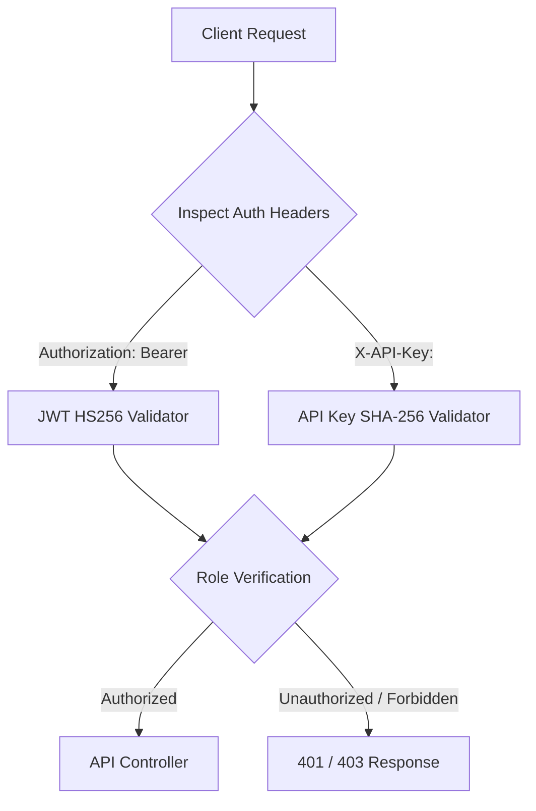

# Security & Authentication Architecture

The system features dual-channel authentication supporting human operators and automated machine clients.

---

## Architecture Flow

---

## 1. Interactive Sessions (JWT)

- **Access Token**: Valid for 30 minutes. Carries claims: `sub` (User UUID), `username`, and `role`.
- **Refresh Token**: Valid for 7 days. Stored securely and renewed via `/api/v1/auth/refresh`.
- **Password Storage**: Cryptographic salted hashes generated with Passlib/Bcrypt.

---

## 2. Headless Client Authentication (API Keys)

- **Format**: `wfo_live_<32_hex_characters>` generated via `secrets.token_hex(16)`.
- **Database Storage**: Only the cryptographic SHA-256 digest is persisted in PostgreSQL.
- **Revocation**: Keys can be deactivated on demand via the API without service downtime.

---

## 3. RBAC Permission Matrix

| Operation | Viewer | Operator | Admin |
| :--- | :---: | :---: | :---: |
| Read workflows & health status | Yes | Yes | Yes |
| Inspect templates & metrics | Yes | Yes | Yes |
| Trigger migration workflow | No | Yes | Yes |
| Cancel active migration | No | Yes | Yes |
| Manage Celery schedules | No | Yes | Yes |
| Instantiate templates | No | Yes | Yes |
| DLQ replay & purge | No | No | Yes |
| Register webhooks | No | No | Yes |
| Manage & revoke API keys | No | No | Yes |
